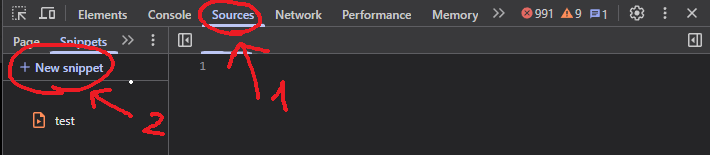

# Macro for Introduction to Networks 

## Instruction manual - Hướng dẫn sử dụng!

B1: Mở bài Checkpoint Exam ra, đợi load xong rồi nhấn nút **Start** để vào bài (phải có câu hỏi thì code mới hoạt động).

B2: Nhấn F12 (vì trang không thể chuột phải), tìm đến ô **Sources** rồi vào phần **Snippet**.

B3: New snippet và dán code  vào khu vực trống.

B4: Chuột phải vào Snippet bạn vừa tạo và nhấn **Run**.

B5: copy toàn bộ file Checkpoint1.md rồi dán vào ô nó vừa hiện ở góc trên giữa màn hình.

B6: Enjoy!!

## 1 số code trên console!

  console.clear() <-- để làm trống console 
  window.stopAutofill() <-- để dừng code không chạy nữa

Cách chỉnh cấu hình

    const AUTO_SKIP = true; // true: tự Skip câu không tìm thấy đáp án
    
    const AUTO_SUBMIT = true; // true: tự Submit sau khi điền
    
    const RELOAD_ANSWER_FILE = true; // false: tái sử dụng ngân hàng trong cùng trang
    
    const LOOP_INTERVAL = 700; // thời gian kiểm tra câu hỏi tiếp theo (ms)

## Lưu ý:
  Nếu bạn thấy nó không làm câu nào thì đợi đến khi làm đến cuối bạn dừng code lại bằng cách vào console nhập **window.stopAutofill()**, bạn có thể vào Checkpoint1.md để xem đáp án vì trong đó có toàn bộ đáp án!
  Nếu bạn tự nhiên thấy code dừng thì hãy giúp nó một chút nhé~!

# DISCLAIMER – TUYÊN BỐ MIỄN TRỪ TRÁCH NHIỆM

**Vui lòng đọc kỹ nội dung này trước khi tải xuống, sao chép, phân phối hoặc sử dụng dự án.**

## 1. Mục đích và phạm vi sử dụng

Dự án này được cung cấp với mục đích nghiên cứu, học tập, thử nghiệm kỹ thuật và tham khảo về lập trình JavaScript, xử lý dữ liệu Markdown, tương tác với DOM và tự động hóa các thao tác trên trình duyệt.

Người sử dụng hoàn toàn chịu trách nhiệm xác định liệu việc sử dụng phần mềm trong trường hợp cụ thể có phù hợp với quy định, điều khoản dịch vụ và chính sách của website hoặc nền tảng liên quan hay không.

Tác giả không khuyến khích việc sử dụng phần mềm để gian lận trong các kỳ thi, bài kiểm tra, hoạt động đánh giá học thuật hoặc thực hiện bất kỳ hành vi nào trái với quy định của tổ chức, cơ sở giáo dục hay nền tảng bên thứ ba.

## 2. Miễn trừ trách nhiệm (Disclaimer of Liability)

Phần mềm được cung cấp **"AS IS" (nguyên trạng)** và **"AS AVAILABLE" (theo khả năng cung cấp)**, không kèm theo bất kỳ cam kết, bảo đảm hoặc tuyên bố nào, dù rõ ràng hay ngụ ý.

Trong phạm vi tối đa được pháp luật hiện hành cho phép, tác giả, người đóng góp và các bên liên quan đến dự án không chịu trách nhiệm đối với bất kỳ tổn thất, thiệt hại, khiếu nại, nghĩa vụ hoặc hậu quả nào phát sinh trực tiếp hoặc gián tiếp từ:

- Việc tải xuống, cài đặt, sao chép, chỉnh sửa, phân phối hoặc sử dụng phần mềm.
- Việc sử dụng phần mềm không đúng mục đích, không đúng hướng dẫn hoặc ngoài phạm vi kiểm soát của tác giả.
- Các thao tác tự động không chính xác, bao gồm nhưng không giới hạn ở việc chọn sai đáp án, bỏ qua câu hỏi, nhấn nhầm nút, gửi câu trả lời hoặc thay đổi trạng thái trên website.
- Việc mất dữ liệu, hư hỏng dữ liệu, mất tiến trình, mất kết quả, sai lệch kết quả hoặc không thể khôi phục trạng thái ban đầu.
- Việc bị cảnh cáo, khóa tài khoản, hạn chế quyền truy cập, đình chỉ dịch vụ hoặc chịu bất kỳ hình thức xử lý nào từ nền tảng bên thứ ba.
- Việc vi phạm quy định học thuật, nội quy tổ chức, điều khoản dịch vụ hoặc chính sách sử dụng của website.
- Các lỗi phần mềm, lỗi tương thích trình duyệt, thay đổi cấu trúc DOM, thay đổi API hoặc những thay đổi khác từ nền tảng bên thứ ba.
- Các thiệt hại trực tiếp, gián tiếp, ngẫu nhiên, đặc biệt, mang tính trừng phạt hoặc hậu quả phát sinh từ việc sử dụng hay không thể sử dụng phần mềm.

Không có bảo đảm rằng phần mềm sẽ hoạt động liên tục, không có lỗi, đáp ứng mọi trường hợp sử dụng hoặc tạo ra kết quả chính xác.

## 3. Trách nhiệm của người sử dụng

Bằng việc tải xuống, sao chép, chỉnh sửa hoặc chạy phần mềm, người sử dụng xác nhận rằng mình:

1. Tự chịu trách nhiệm đối với mọi hành động thực hiện bằng phần mềm.
2. Tự đánh giá các rủi ro trước khi chạy mã nguồn trên trình duyệt hoặc website của bên thứ ba.
3. Có trách nhiệm kiểm tra tính chính xác của kết quả trước khi xác nhận hoặc gửi bất kỳ thông tin nào.
4. Có trách nhiệm tuân thủ luật pháp, quy định của tổ chức, chính sách học thuật và điều khoản sử dụng của nền tảng liên quan.
5. Hiểu rằng các thao tác được thực hiện tự động có thể gây ra hậu quả không mong muốn và không phải lúc nào cũng có thể hoàn tác.
6. Tự chịu trách nhiệm đối với việc chỉnh sửa, phát triển thêm, phân phối lại hoặc kết hợp mã nguồn này với các phần mềm khác.

Người sử dụng không được mặc định rằng tác giả đã kiểm tra, phê duyệt hoặc bảo đảm an toàn cho mọi phiên bản chỉnh sửa, bản fork hoặc bản phân phối lại của dự án.

## 4. Không bảo đảm tính chính xác và độ tin cậy

Tác giả không cam kết:

- Mọi câu trả lời trong dữ liệu Markdown đều chính xác.
- Thuật toán nhận diện câu hỏi luôn tìm được đáp án tương ứng.
- Cơ chế so khớp văn bản không nhầm lẫn giữa các câu hỏi tương tự.
- Các thao tác tự động luôn tương thích với mọi phiên bản website.
- Các chức năng tự động Skip hoặc Submit luôn hoạt động đúng như dự kiến.
- Phần mềm đáp ứng mọi yêu cầu về bảo mật, hiệu năng hoặc khả năng tương thích.

Người sử dụng cần tự kiểm tra và đánh giá kết quả trước khi thực hiện những hành động có tính quyết định.

## 5. Nền tảng và dịch vụ của bên thứ ba

Dự án không thuộc sở hữu, không được tài trợ, không được chứng nhận và không có mối liên kết chính thức với bất kỳ website, tổ chức giáo dục, đơn vị cung cấp dịch vụ hoặc nhà phát triển nền tảng bên thứ ba nào, trừ khi có tuyên bố rõ ràng khác.

Mọi tên thương hiệu, nhãn hiệu, tên miền và tài sản trí tuệ của bên thứ ba được sử dụng trong tài liệu chỉ nhằm mục đích tham chiếu.

Tác giả không chịu trách nhiệm đối với:

- Thay đổi chính sách hoặc điều khoản dịch vụ của bên thứ ba.
- Sự cố kỹ thuật hoặc gián đoạn dịch vụ của bên thứ ba.
- Các quyết định xử lý tài khoản do bên thứ ba đưa ra.
- Việc bên thứ ba sử dụng, lưu trữ hoặc xử lý dữ liệu của người sử dụng.

## 6. Phiên bản chỉnh sửa và phân phối lại

Mã nguồn có thể được sao chép, fork, chỉnh sửa hoặc phân phối lại bởi các cá nhân khác, tùy thuộc vào giấy phép của dự án.

Tác giả ban đầu không chịu trách nhiệm đối với những thay đổi, chức năng bổ sung, mã độc, hành vi hoặc hậu quả phát sinh từ các phiên bản không do tác giả trực tiếp kiểm soát.

Việc fork hoặc phân phối lại mã nguồn không đồng nghĩa với việc tác giả ban đầu chứng thực hoặc bảo đảm cho phiên bản đó.

## 7. Giới hạn pháp lý

Các nội dung miễn trừ trách nhiệm trong tài liệu này được áp dụng trong phạm vi tối đa mà pháp luật hiện hành cho phép.

Không nội dung nào trong tài liệu này được hiểu là loại trừ hoặc hạn chế những trách nhiệm pháp lý mà pháp luật không cho phép loại trừ hoặc hạn chế.

Nếu một điều khoản trong tài liệu này bị xác định là không hợp lệ hoặc không thể thực thi, các điều khoản còn lại vẫn được áp dụng trong phạm vi pháp luật cho phép.

## 8. Chấp thuận điều khoản

Bằng việc tải xuống, sao chép, fork, chỉnh sửa, phân phối hoặc sử dụng dự án, người sử dụng xác nhận rằng mình đã đọc, hiểu và đồng ý với các nội dung miễn trừ trách nhiệm được trình bày trong tài liệu này.

**NẾU KHÔNG ĐỒNG Ý VỚI BẤT KỲ NỘI DUNG NÀO Ở TRÊN, VUI LÒNG KHÔNG TẢI XUỐNG, CÀI ĐẶT, SAO CHÉP HOẶC SỬ DỤNG DỰ ÁN.**

---

**Copyright © Project Contributors. All rights reserved according to the project's applicable license.**
